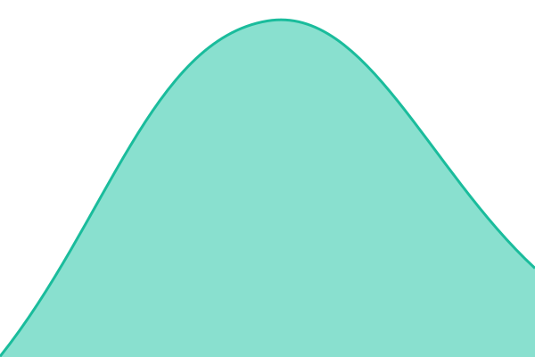
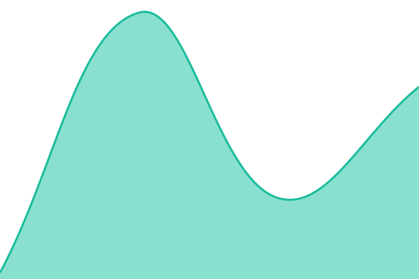

# [📈 Live Status](https://ffox-git.github.io/DownDetectionForOUTlook): <!--live status--> **🟧 Partial outage**

This repository contains the open-source uptime monitor and status page for [UwUr](https://ffox-git.github.io/DownDetectionForOUTlook), powered by [Upptime](https://github.com/upptime/upptime).

With [Upptime](https://upptime.js.org), you can get your own unlimited and free uptime monitor and status page, powered entirely by a GitHub repository. We use [Issues](https://github.com/ffox-git/DownDetectionForOUTlook/issues) as incident reports, [Actions](https://github.com/ffox-git/DownDetectionForOUTlook/actions) as uptime monitors, and [Pages](https://ffox-git.github.io/DownDetectionForOUTlook) for the status page.

<!--start: status pages-->
<!-- This summary is generated by Upptime (https://github.com/upptime/upptime) -->
<!-- Do not edit this manually, your changes will be overwritten -->
<!-- prettier-ignore -->
| URL | Status | History | Response Time | Uptime |
| --- | ------ | ------- | ------------- | ------ |
|  [Outlook (Office)](https://outlook.office.com) | 🟥 Down | [outlook-office.yml](https://github.com/ffox-git/DownDetectionForOUTlook/commits/HEAD/history/outlook-office.yml) | 

 0ms
     
 | 

<a href="https://ffox-git.github.io/DownDetectionForOUTlook/history/outlook-office">33.88%</a>
    

|  [Outlook (Live)](https://outlook.live.com) | 🟥 Down | [outlook-live.yml](https://github.com/ffox-git/DownDetectionForOUTlook/commits/HEAD/history/outlook-live.yml) | 

 0ms
     
 | 

<a href="https://ffox-git.github.io/DownDetectionForOUTlook/history/outlook-live">51.66%</a>
    

|  [Exchange Online](https://outlook.office365.com) | 🟥 Down | [exchange-online.yml](https://github.com/ffox-git/DownDetectionForOUTlook/commits/HEAD/history/exchange-online.yml) | 

 0ms
     
 | 

<a href="https://ffox-git.github.io/DownDetectionForOUTlook/history/exchange-online">67.98%</a>
    

|  [Teams](https://teams.microsoft.com) | 🟩 Up | [teams.yml](https://github.com/ffox-git/DownDetectionForOUTlook/commits/HEAD/history/teams.yml) | 

 222ms
     
 | 

<a href="https://ffox-git.github.io/DownDetectionForOUTlook/history/teams">100.00%</a>
    

|  [Microsoft 365](https://www.microsoft365.com) | 🟩 Up | [microsoft-365.yml](https://github.com/ffox-git/DownDetectionForOUTlook/commits/HEAD/history/microsoft-365.yml) | 

 88ms
     
 | 

<a href="https://ffox-git.github.io/DownDetectionForOUTlook/history/microsoft-365">100.00%</a>
    

|  [Office Portal](https://www.office.com) | 🟩 Up | [office-portal.yml](https://github.com/ffox-git/DownDetectionForOUTlook/commits/HEAD/history/office-portal.yml) | 

 96ms
     
 | 

<a href="https://ffox-git.github.io/DownDetectionForOUTlook/history/office-portal">100.00%</a>
    

|  [Copilot](https://copilot.microsoft.com) | 🟩 Up | [copilot.yml](https://github.com/ffox-git/DownDetectionForOUTlook/commits/HEAD/history/copilot.yml) | 

 177ms
     
 | 

<a href="https://ffox-git.github.io/DownDetectionForOUTlook/history/copilot">100.00%</a>
    

|  [Sign-in](https://login.microsoftonline.com) | 🟩 Up | [sign-in.yml](https://github.com/ffox-git/DownDetectionForOUTlook/commits/HEAD/history/sign-in.yml) | 

 659ms
     
 | 

<a href="https://ffox-git.github.io/DownDetectionForOUTlook/history/sign-in">100.00%</a>
    

|  [Admin Center](https://admin.microsoft.com) | 🟩 Up | [admin-center.yml](https://github.com/ffox-git/DownDetectionForOUTlook/commits/HEAD/history/admin-center.yml) | 

 219ms
     
 | 

<a href="https://ffox-git.github.io/DownDetectionForOUTlook/history/admin-center">100.00%</a>
    

|  [OneDrive](https://onedrive.live.com) | 🟩 Up | [one-drive.yml](https://github.com/ffox-git/DownDetectionForOUTlook/commits/HEAD/history/one-drive.yml) | 

 58ms
     
 | 

<a href="https://ffox-git.github.io/DownDetectionForOUTlook/history/one-drive">100.00%</a>
    

|  [Azure Portal](https://portal.azure.com) | 🟩 Up | [azure-portal.yml](https://github.com/ffox-git/DownDetectionForOUTlook/commits/HEAD/history/azure-portal.yml) | 

 28ms
     
 | 

<a href="https://ffox-git.github.io/DownDetectionForOUTlook/history/azure-portal">9.29%</a>
    

|  [Microsoft](https://www.microsoft.com) | 🟥 Down | [microsoft.yml](https://github.com/ffox-git/DownDetectionForOUTlook/commits/HEAD/history/microsoft.yml) | 

 76ms
     
 | 

<a href="https://ffox-git.github.io/DownDetectionForOUTlook/history/microsoft">99.31%</a>
    

<!--end: status pages-->

[**Visit our status website →**](https://ffox-git.github.io/DownDetectionForOUTlook)

## 📄 License

- Powered by: [Upptime](https://github.com/upptime/upptime)
- Code: [MIT](./LICENSE) © [Anand Chowdhary](https://anandchowdhary.com)
- Data in the `./history` directory: [Open Database License](https://opendatacommons.org/licenses/odbl/1-0/)
